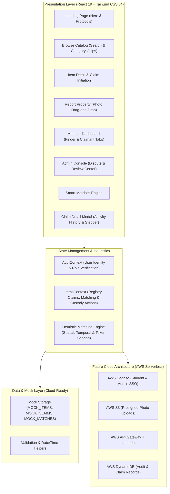
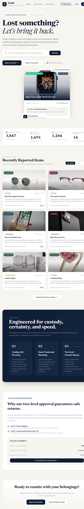
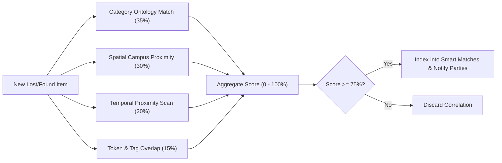
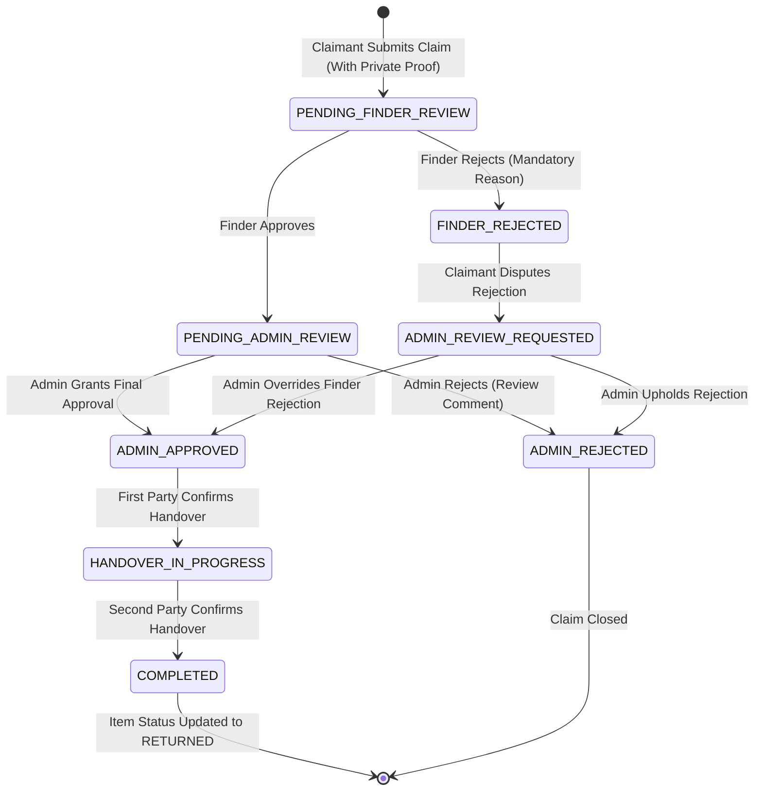

# FindIt – Live Demonstration & Evaluation Script

This document provides a comprehensive, step-by-step presentation script for conducting live demonstrations of the **FindIt – Smart Lost & Found Portal**. It details exact presenter actions, user roles, system responses, and embeds the verified architecture and workflow diagrams.

---

## 1. System Overview & Architecture Walkthrough

### 1.1 Presenter Introduction
> *"FindIt is a high-integrity, editorial-grade lost and found platform designed for institutional campuses. Rather than relying on informal group chats with unverified handouts, FindIt pairs an automated heuristic correlation engine with an auditable Two-Level Claim Approval & Physical Handover Protocol."*

### 1.2 Platform Visual Design
The platform employs an editorial glass marketplace aesthetic, ensuring intuitive navigation and transparent institutional custody:

---

## 2. Live Demo Script: Step-by-Step Execution

### Step 1: Public Registry & Filter Verification
* **Goal**: Demonstrate public access, real-time filtering, and URL parameter synchronization.
* **Navigation**: Open `http://localhost:5173/browse`
* **Actions**:
  1. Click the **Found Items** filter pill. Observe item counts dynamically update.
  2. Select category **Electronics**. Observe instant narrowing of catalog cards.
  3. Type `MacBook` into the search box.
  4. Note that the browser URL updates to `/browse?type=found&category=Electronics&q=MacBook`, allowing bookmarking and sharing.
  5. Click **Reset Filters** to restore full catalog view.

---

### Step 2: Found Item Reporting & Secure Photo Upload
* **Goal**: Demonstrate item registration backed by S3 presigned URL image storage.
* **Authentication**: Sign in as Finder (`john.doe@example.com` / `Password123!`).
* **Navigation**: Click **Report an Item** (`/report`).
* **Actions**:
  1. Select **"I Found an Item"**.
  2. Enter Item Title: `Blue Hydro Flask Water Bottle`.
  3. Select Category: `Bottles` (or `Accessories`).
  4. Campus Location: `Central Library, 2nd Floor Study Room`.
  5. Select Incident Date: Today's date.
  6. Upload a photo via drag-and-drop. The frontend requests an S3 presigned PUT URL from `POST /uploads/presign` and uploads the asset directly to private S3 storage.
  7. Enter Detailed Description: `Stainless steel hydro flask with campus sticker found near desk 14.`
  8. Submit Report. Observe toast notification and redirection to the item details page (`/items/:id`).

---

### Step 3: Heuristic Smart Matching Engine Execution
* **Goal**: Demonstrate live algorithmic cross-correlation between lost reports and found reports.

* **Navigation**: Navigate to **Smart Matches** (`/matches`).
* **Actions**:
  1. Toggle between **"All Campus Correlations"** and **"My Reports Only"**.
  2. Observe the symmetrical 3-column correlation cards (Lost Item on left, Score Ring in center, Found Item on right).
  3. Inspect the center confidence score indicator (e.g., $96\%$).
  4. Review the breakdown metrics and leading correlation tags (*"Exact Category Match"*, *"Coincident Location Zone"*, *"Temporal Proximity"*).
  5. Click **"File Claim"** on the matching found listing.

---

### Step 4: Two-Level Claim Approval & Physical Handover Protocol
* **Goal**: Demonstrate fraud-resistant verification with private proof shielding and dual confirmation.

#### Phase A: Claim Submission (Claimant)
1. Authenticate as Claimant (`sarah.johnson@example.com`).
2. Navigate to the found item detail page. Click **"Claim This Item"**.
3. Complete the claim form with **Private Verification Descriptors**:
   - *Reason for Claim*: "This is my bottle lost yesterday during the study session."
   - *Private Verification Proof*: "Has a small dent on the bottom rim and a DSCE ACM student sticker on the back."
4. Submit Claim. Item status transitions to `claimed` (reserved), and claim status initializes as `PENDING_FINDER_REVIEW`.

#### Phase B: Level 1 – Finder Verification (Physical Custodian)
1. Sign in as the Finder (`john.doe@example.com`).
2. Navigate to **Finder Dashboard** (`/finder`).
3. Click on the incoming claim card. Inspect the claimant's private verification details.
4. Verify physical marks on the custody item.
5. Click **"Approve Claim"**. Status transitions to `PENDING_ADMIN_REVIEW`.

#### Phase C: Level 2 – Campus Administrator Authorization
1. Sign in as Campus Administrator (`emma.wilson@example.com`).
2. Navigate to **Admin Dashboard** (`/admin`).
3. In the Claims Review Queue, locate the pending claim.
4. Review item history, finder approval timestamp, and evidence integrity.
5. Enter Administrative Authorization Rationale: "Verified student enrollment and physical description consistency."
6. Click **"Authorize Release"**. Status transitions to `ADMIN_APPROVED`.

#### Phase D: Dual Handover Confirmation
1. **Finder Confirmation**: Finder navigates to the claim card and clicks **"Confirm Physical Handover"**. Status transitions to `HANDOVER_IN_PROGRESS`.
2. **Claimant Receipt Confirmation**: Claimant logs in, navigates to `/dashboard`, and clicks **"Confirm Item Received"**.
3. Both confirmations are fulfilled: Status transitions to `COMPLETED`. Associated item status is atomically updated to `returned`.
4. Attempting to claim the item again is permanently blocked by backend transaction guards.

---

### Step 5: Admin Analytics & Auditable Trail
* **Goal**: Demonstrate governance, oversight, and dispute resolution.
* **Navigation**: Admin Dashboard (`/admin`).
* **Actions**:
  1. Inspect metric tiles: Total Listings, Active Disputes, Resolved Claims, Verified Custodians.
  2. View the Claims Custody Table with real-time status filtering (`PENDING_ADMIN_REVIEW`, `ADMIN_APPROVED`, `DISPUTED`, `COMPLETED`).
  3. Inspect the user directory and role management controls.

---

## 3. Reused Diagrams vs. Missing Diagrams Summary

For complete documentation inventory, consult [`docs/demo/DIAGRAM_INDEX.md`](docs/demo/DIAGRAM_INDEX.md).

- **Reused Diagrams**:
  - `docs/demo/diagrams/system-architecture.mmd`: Layered client-serverless architecture.
  - `docs/demo/diagrams/claim-workflow-state-machine.mmd`: 4-phase claim lifecycle state machine.
  - `docs/demo/diagrams/smart-matching-pipeline.mmd`: Heuristic correlation pipeline.
  - `docs/demo/diagrams/findit-editorial-ui-overview.png`: Authentic platform screenshot & layout.
- **Explicitly Documented Missing Diagrams**:
  - Data Flow Diagram (DFD)
  - Use Case Diagram
  - Sequence Diagram
  - DynamoDB Data Model Diagram / ERD

