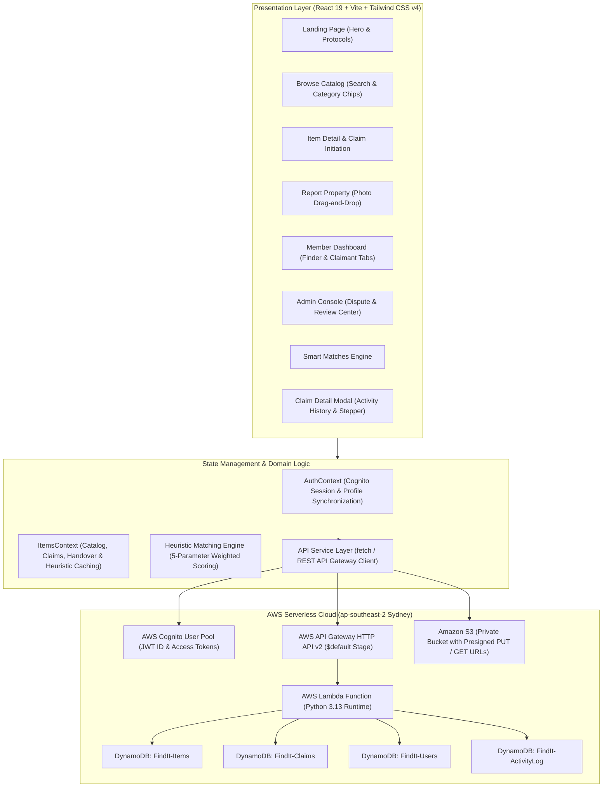
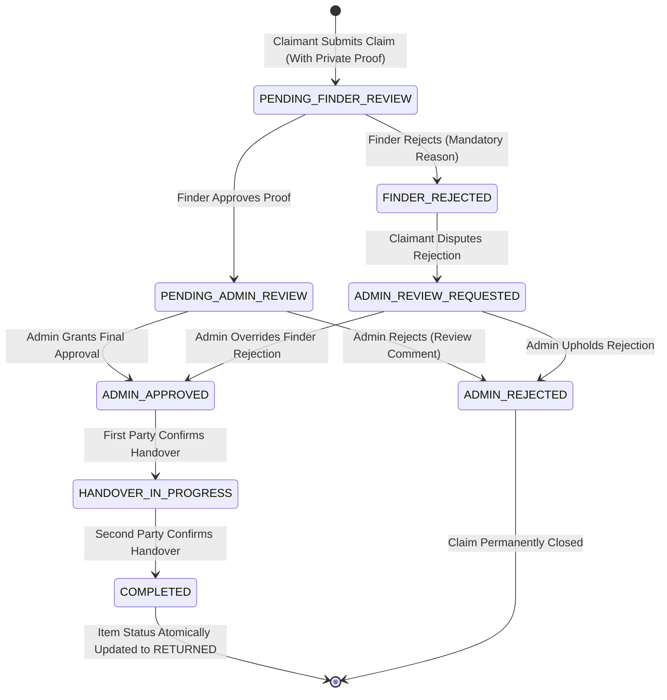
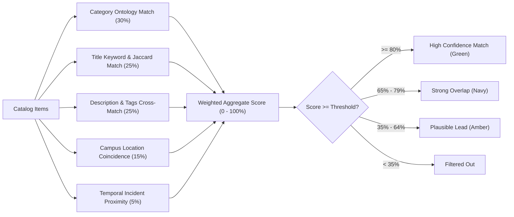

# FindIt – Smart Lost & Found Portal

[](LICENSE)
[](https://react.dev/)
[](https://tailwindcss.com/)
[](https://aws.amazon.com/)
[](https://www.python.org/)
[](test_audit.mjs)

**FindIt** is a high-integrity, editorial-grade lost and found platform engineered for university campuses, institutional networks, and smart communities (tailored for Dayananda Sagar College of Engineering – DSCE, Bengaluru).

Unlike informal WhatsApp groups or unstructured social feeds where items are handed over without verification, FindIt combines an **automated heuristic correlation engine** with an auditable **Two-Level Claim Approval & Physical Handover Protocol**, backed by an **AWS serverless architecture**.

---

## 🌟 Key Features

### 🏛️ 1. Editorial Glass Marketplace UI
- **Refined Color System**: Deep Navy (`#101D36`), Dark Navy (`#172944`), Off-White (`#F7F5EF`), Soft Blue (`#DCE5EF`), and Muted Steel (`#8999AE`).
- **Typography Hierarchy**: Classical serif headline accents (**Newsreader**) combined with **Plus Jakarta Sans** and **Inter** for responsive data controls and tabular clarity.
- **Authentic Visual Registry**: High-resolution image previews, fallback iconography, drag-and-drop photo uploading via S3 presigned URLs, and mobile-responsive layout.

### 🔍 2. Real-Time Search & Parametric Filtering
- Instant multi-field keyword filtering across item names, campus locations, descriptions, and category tags.
- Segmented **Lost** vs. **Found** tab controls with live catalog counter badges.
- Bidirectional URL query synchronization (`/browse?type=found&category=Electronics&q=MacBook`) for bookmarking and sharable search results.

### ⚡ 3. Live Heuristic Smart Matching Engine
- **Automated Cross-Correlation**: Evaluates active lost listings against found listings in real-time without manual intervention.
- **Transparent 5-Factor Weighted Scoring**:
  - **Category Similarity (30%)**: Exact match (30 pts) or compatible category overlap (20 pts).
  - **Title Similarity (25%)**: Exact title (25 pts), substring overlap (22 pts), or token Jaccard similarity (10–25 pts).
  - **Description & Tags (25%)**: Multi-token descriptor and tag matching with title cross-referencing (10–25 pts).
  - **Location Coincidence (15%)**: Same campus spot (15 pts), zone coincidence (12 pts), or landmark vicinity (5–10 pts).
  - **Temporal Proximity (5%)**: Same day (5 pts), $\le 2$ days (4 pts), $\le 7$ days (3 pts), $\le 14$ days (2 pts), $\le 30$ days (1 pt).
- **Safety Guardrails**: Strictly pairs `lost` to `found` items, excludes returned/resolved items, blocks self-reported matches, and clamps scores between $0\%$ and $100\%$.
- **Interactive UI**: Symmetrical 3-column correlation inspection cards, circular SVG score rings, scope selector (**All Campus Correlations** vs. **My Reports Only**), and confidence threshold filters ($35\%+$, $65\%+$, $80\%+$).

### 🛡️ 4. Two-Level Claim Approval & Handover Protocol
- **Confidential Proof Submission**: Claimants provide private verification traits (serial numbers, hidden engravings, lockscreen images, inner compartment contents) that remain shielded from the public and unverified parties.
- **Level 1 (Finder Validation)**: The physical custodian verifies the claimant's private descriptors against the physical item and either approves to administration or rejects with a mandatory explanation.
- **Dispute Resolution**: Claimants can appeal a finder rejection directly to campus administration.
- **Level 2 (Admin Authorization)**: Authorized campus administrators inspect private evidence, resolve disputes, and grant final release authorization.
- **Dual Physical Handover Confirmation**: Both finder and claimant must independently confirm the physical exchange before the claim transitions to `COMPLETED` and the item is atomically sealed as `RETURNED`.
- **Integrity Safeguards**: Backend transaction guards prevent claiming self-reported items, duplicate active claims on the same item, and claiming already returned items.

### 📊 5. Role-Based Dashboards
- **Student Dashboard (`/dashboard`)**: Tabbed interface tracking *My Listings*, *My Claims (Claimant)*, and incoming correlation alerts.
- **Finder Dashboard (`/finder`)**: Focused custody workbench for campus members currently holding found items, reviewing incoming verification proofs.
- **Admin Console (`/admin`)**: Institutional management suite with platform analytics, dispute arbitration queue, claims custody table, and user directory.

---

## 🏗️ System Architecture

The application adopts a decoupled serverless cloud architecture pairing a modern React client with AWS serverless infrastructure:



---

## 🔄 Two-Level Claim Verification State Machine

Every ownership claim transitions through an auditable four-phase verification lifecycle:



---

## ⚡ Smart Matching Scoring Pipeline



---

## 🛠️ Technology Stack

| Layer | Technologies | Purpose |
| :--- | :--- | :--- |
| **Frontend Framework** | **[React 19](https://react.dev/)** + **[Vite 8](https://vite.dev/)** | Fast client-side rendering and module bundling |
| **Styling & Design System** | **[Tailwind CSS v4](https://tailwindcss.com/)** | Bespoke glassmorphism design tokens and layout primitives |
| **Routing** | **[React Router v7](https://reactrouter.com/)** | Client routing with bidirectional URL query synchronization |
| **Icons & Typography** | **[Lucide React](https://lucide.dev/)**, **Newsreader**, **Inter** | Scalable SVG icons and editorial typographic styling |
| **State Management** | **React Context API** (`AuthContext`, `ItemsContext`) | Dynamic memoized state, live matching, and claims mutations |
| **Authentication** | **[AWS Cognito](https://aws.amazon.com/cognito/)** (`aws-amplify/auth`) | Secure JWT token sessions, user verification, and role attributes |
| **Compute / API** | **[AWS API Gateway](https://aws.amazon.com/api-gateway/)** + **[AWS Lambda](https://aws.amazon.com/lambda/)** (Python 3.13) | Serverless REST endpoints with atomic DynamoDB transactions |
| **Database** | **[Amazon DynamoDB](https://aws.amazon.com/dynamodb/)** (4 Tables) | Low-latency NoSQL data persistence for catalog, claims, users, and logs |
| **Media Storage** | **[Amazon S3](https://aws.amazon.com/s3/)** | Private encrypted asset storage accessed via presigned upload URLs |
| **Quality & Linting** | **[Oxlint](https://oxc.rs/)** + Automated Node test suite | Static analysis and end-to-end state machine verification |

---

## 📁 Repository Structure

```text
findit/
├── .env.example               # Environment variables configuration template
├── .gitignore                 # Comprehensive git exclusion rules
├── .oxlintrc.json             # Linter rule configuration
├── index.html                 # HTML entry point with web fonts
├── package.json               # Dependencies and build scripts
├── test_audit.mjs             # Automated 38-point unit & state machine test suite
├── vite.config.js             # Vite configuration with Tailwind CSS v4
├── aws/
│   └── lambda/
│       └── lambda_function.py # AWS Lambda backend handler (Python 3.13)
├── docs/
│   └── demo/
│       ├── DIAGRAM_INDEX.md   # Master inventory of project diagrams
│       ├── DEMO_SCRIPT.md     # Step-by-step evaluator presentation script
│       ├── SYSTEM_ARCHITECTURE.md # Architectural specifications and AWS topology
│       └── diagrams/          # Preserved Mermaid (.mmd) and UI asset diagrams
├── public/                    # Static favicon and icon assets
├── src/
│   ├── App.jsx                # Application router and route guards
│   ├── index.css              # Tailwind v4 theme tokens and glass styles
│   ├── main.jsx               # React DOM application mount
│   ├── assets/                # Visual branding assets
│   ├── components/            # Reusable UI components
│   │   ├── Badge.jsx          # Workflow & item status badges
│   │   ├── ClaimDetailModal.jsx # Multi-step claim verification & handover dialog
│   │   ├── EmailVerificationCard.jsx # Cognito verification code input
│   │   ├── Footer.jsx         # Institutional editorial footer
│   │   ├── ItemCard.jsx       # Catalog listing card with photo & status
│   │   └── Navbar.jsx         # Sticky translucent navigation bar
│   ├── config/
│   │   └── awsConfig.js       # AWS Cognito, API Gateway, and S3 configuration
│   ├── context/
│   │   ├── AuthContext.jsx    # Cognito session, login, signup & profile provider
│   │   └── ItemsContext.jsx   # Real AWS items, claims, and live matching provider
│   ├── data/
│   │   └── mockData.js        # Category definitions and campus locations
│   ├── layouts/
│   │   └── MainLayout.jsx     # Master layout wrapper with Navbar and Footer
│   ├── pages/                 # Primary page views
│   │   ├── AdminPage.jsx      # Campus administrator console and dispute queue
│   │   ├── BrowsePage.jsx     # Filterable lost & found catalog registry
│   │   ├── DashboardPage.jsx  # User dashboard with personal listings & claims
│   │   ├── FinderPage.jsx     # Physical custodian claim review workbench
│   │   ├── ItemDetailPage.jsx # Item inspection, claim submission & lightbox
│   │   ├── LandingPage.jsx    # Editorial hero, metrics & operational protocols
│   │   ├── LoginPage.jsx      # Authentication screen with demo quick-switches
│   │   ├── MatchesPage.jsx    # Live Heuristic Smart Matching engine
│   │   ├── RegisterPage.jsx   # User registration with password strength meter
│   │   └── ReportPage.jsx     # Property reporting form with photo upload
│   ├── services/
│   │   └── api.js             # AWS API Gateway client (items, claims, presign)
│   └── utils/
│       ├── helpers.js         # Formatting, tokenization, and date utilities
│       └── matching.js        # 5-factor weighted smart matching algorithm
├── DEMO_SCRIPT.md             # Live demo presentation script
└── SYSTEM_ARCHITECTURE.md     # In-depth architectural documentation
```

---

## 🚀 Getting Started

### Prerequisites
- **Node.js**: v18.0.0 or higher
- **npm**: v9.0.0 or higher
- An active AWS Account (if deploying the serverless backend)

### 1. Installation
Clone the repository and install dependencies:
```bash
git clone https://github.com/your-username/findit.git
cd findit
npm install
```

### 2. Environment Setup
Copy the example environment configuration:
```bash
cp .env.example .env.local
```

Configure your AWS resources in `.env.local`:
```ini
VITE_AWS_REGION=ap-southeast-2
VITE_COGNITO_USER_POOL_ID=your_cognito_user_pool_id
VITE_COGNITO_CLIENT_ID=your_cognito_app_client_id
VITE_API_BASE_URL=https://your-api-id.execute-api.ap-southeast-2.amazonaws.com
```

### 3. Running Locally
Start the development server:
```bash
npm run dev
```
Open your browser and navigate to:
```
http://localhost:5173/
```

### 4. Production Build & Linting
Compile the optimized production bundle:
```bash
npm run build
```

Run static analysis using Oxlint:
```bash
npm run lint
```

### 5. Automated Audit Test Suite
Execute the 38-point automated test suite verifying user roles, claims state machine, dispute overrides, and matching guardrails:
```bash
node test_audit.mjs
```

---

## 🔑 Demo & Test Accounts

| Persona | Email | Purpose / Testing Workflow |
| :--- | :--- | :--- |
| **Student / Claimant** | `sarah.johnson@example.com` | Report lost items, browse catalog, file claims with confidential proof, confirm item receipt |
| **Physical Custodian / Finder** | `john.doe@example.com` | Report found items, review incoming claims, inspect private proof, confirm physical handover |
| **Campus Administrator** | `emma.wilson@example.com` | Access `/admin`, review escalated claims, override disputed rejections, audit custody logs |

---

## 📖 Supplementary Documentation

- ☁️ **[Cloud Backend Setup Guide](CLOUD_BACKEND_SETUP.md)**: Complete step-by-step instructions to configure and connect AWS Cognito, DynamoDB, S3, API Gateway, and Lambda.
- 📐 **[System Architecture Specifications](SYSTEM_ARCHITECTURE.md)**: Deep dive into the AWS serverless topology, DynamoDB schemas, and security controls.
- 🎬 **[Live Demo & Presentation Script](DEMO_SCRIPT.md)**: Step-by-step evaluator walkthrough covering all 13 core workflows.
- 📊 **[Diagram Index & Asset Catalog](docs/demo/DIAGRAM_INDEX.md)**: Master inventory detailing all reused and audited project diagrams.
