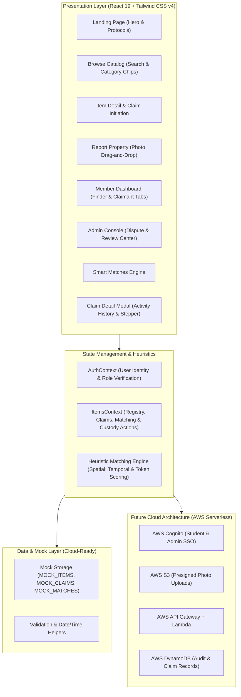
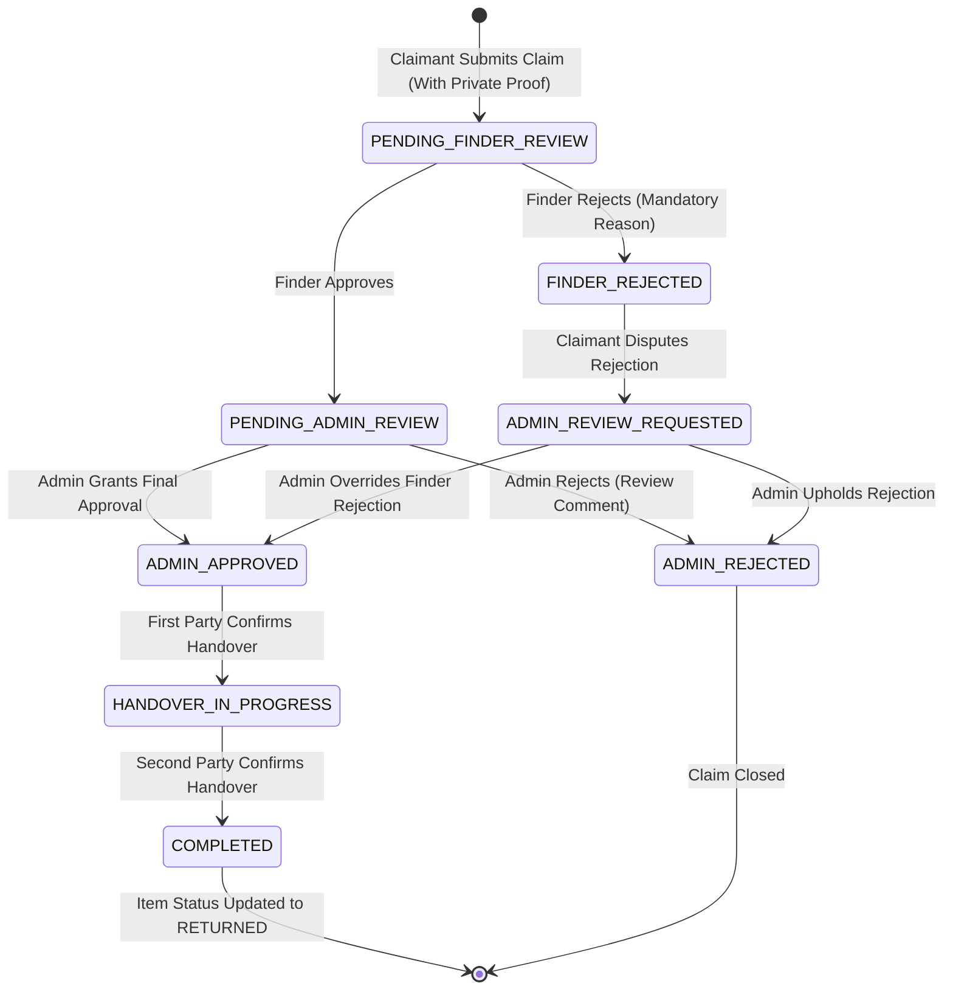
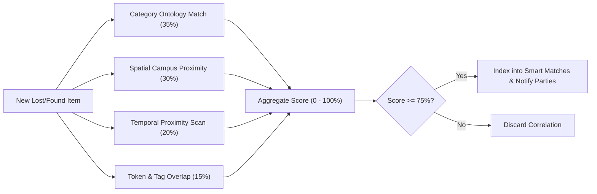
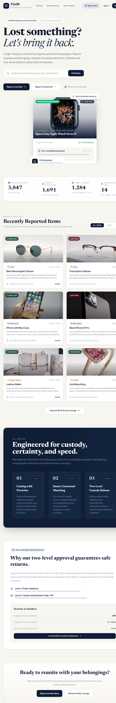

# FindIt – System Architecture & Technical Specifications

**FindIt** is a high-integrity, editorial-grade lost and found platform engineered for campus networks (tailored for Dayananda Sagar College of Engineering – DSCE, Bengaluru). It combines automated heuristic smart matching with a strict **Two-Level Claim Approval & Physical Handover Protocol**, backed by an AWS serverless architecture.

---

## 1. High-Level System Architecture

The application adopts a decoupled serverless architecture combining a React 19 single-page application with AWS managed cloud services.

*Raw Diagram Definition File: [`docs/demo/diagrams/system-architecture.mmd`](diagrams/system-architecture.mmd)*

---

## 2. Core Operational Workflows & State Machines

### 2.1 Two-Level Claim Approval & Handover Protocol

Every ownership claim transitions through an auditable four-phase verification lifecycle. Private descriptors provided during claim creation (such as serial numbers, engraved markings, or lockscreen wallpapers) remain encrypted and hidden from unauthorized parties.

*Raw Diagram Definition File: [`docs/demo/diagrams/claim-workflow-state-machine.mmd`](diagrams/claim-workflow-state-machine.mmd)*

### 2.2 Smart Matching Engine Heuristic Pipeline

When reports are registered in the catalog, the automated heuristic correlation engine evaluates cross-listing compatibility across five independent parameters:

*Raw Diagram Definition File: [`docs/demo/diagrams/smart-matching-pipeline.mmd`](diagrams/smart-matching-pipeline.mmd)*

---

## 3. Platform Interface & Visual Design

The FindIt platform utilizes an **Editorial Glass Marketplace** aesthetic, designed to convey physical custody assurance and institutional credibility:

*Figure 1: Full-page overview of the FindIt Editorial UI showing verified metrics, recently reported item listings, the 3-step operational protocol banner, and institutional two-level security documentation.*

---

## 4. Diagram Catalog & Missing Diagrams Audit

In accordance with project documentation standards, all diagrams were audited across the codebase and assets. Where an existing diagram was available, it was preserved and reused without alteration. Missing diagrams are explicitly documented below:

| Diagram Type | Status | Source / Location | Audit Finding & Action |
|---|:---:|---|---|
| **System Architecture** | **REUSED** | `README.md` $\to$ `docs/demo/diagrams/system-architecture.mmd` | Preserved original layered architecture diagram. |
| **Claim State Machine** | **REUSED** | `README.md` $\to$ `docs/demo/diagrams/claim-workflow-state-machine.mmd` | Preserved complete 4-phase claim lifecycle diagram. |
| **Smart Matching Pipeline** | **REUSED** | `README.md` $\to$ `docs/demo/diagrams/smart-matching-pipeline.mmd` | Preserved heuristic calculation pipeline diagram. |
| **UI Layout & Flow** | **REUSED** | `127.0.0.1_5173_.png` $\to$ `docs/demo/diagrams/findit-editorial-ui-overview.png` | Reused authentic UI asset showing operational design. |
| **Data Flow Diagram (DFD)** | **MISSING** | *Not in repository* | **Missing.** Process transformations are implemented in `ItemsContext.jsx` and `lambda_function.py`, but no formal DFD asset was previously produced. |
| **Use Case Diagram** | **MISSING** | *Not in repository* | **Missing.** Role boundaries (Claimant, Finder, Admin) are fully active in code, but no visual UML Use Case diagram was previously stored. |
| **Sequence Diagram** | **MISSING** | *Not in repository* | **Missing.** Asynchronous request lifecycles are documented in code, but no UML Sequence Diagram was previously saved. |
| **DynamoDB Data Model / ERD** | **MISSING** | *Not in repository* | **Missing.** The 4-table DynamoDB schema exists in `lambda_function.py`, but no physical ERD diagram asset was previously created. |

---

## 5. Technology Stack & Cloud Infrastructure

### Frontend Architecture
- **Framework**: React 19 (Hooks, Context API, dynamic `useMemo` caching)
- **Styling**: Tailwind CSS v4 with custom design tokens (`#101D36`, `#8999AE`, `#DCE5EF`, `#F7F5EF`)
- **Routing**: React Router v7 with URL search parameter state synchronization
- **Icons & Typography**: Lucide React, Google Newsreader serif, Plus Jakarta Sans, Inter

### AWS Serverless Cloud Architecture (Sydney `ap-southeast-2`)
- **Authentication**: AWS Cognito User Pool with JWT ID Token authorization
- **API Management**: AWS API Gateway HTTP API (`$default` stage)
- **Compute Layer**: AWS Lambda running Python 3.13 (`findit-lambda-deployment.zip`)
- **Database (DynamoDB)**:
  - `FindIt-Items`: Item catalog, partition key `itemId`
  - `FindIt-Claims`: Custody claims & private verification descriptors, partition key `claimId`
  - `FindIt-Users`: User identity and role directory (`user` | `admin`), partition key `userId`
  - `FindIt-ActivityLog`: Auditable event trail, partition key `logId`
- **Asset Storage**: Amazon S3 private storage with presigned PUT upload URLs and GET retrieval URLs

